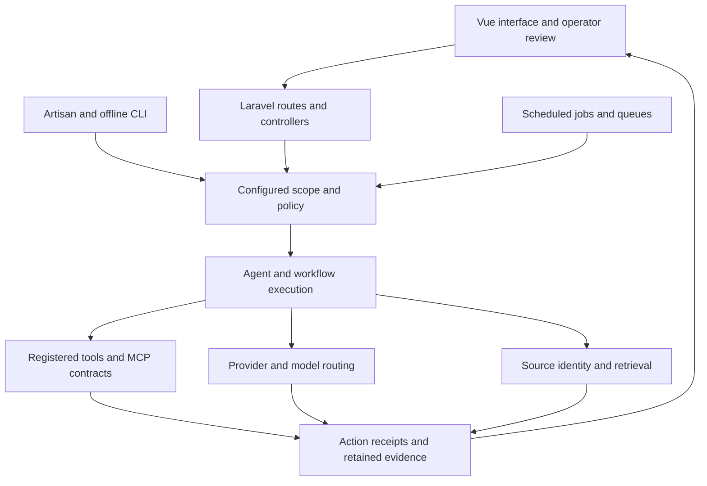

# PLOS Architecture

Offline vision selection retains both registered instance and model through execution; fresh endpoint checks enforce the same vision mapping and eligibility. MCP sidecar schemas transport optional choices to the existing Laravel policy. Colibri research refuses incomplete provider/role registration. These paths reuse existing provider/model tables and admission boundaries; see [table-owned routing](table-owned-llm-routing.md).

## Table-owned LLM routing and lossless input

Runtime provider endpoints, role models and eligibility are read from `llm_instances` through the existing pool. Named route aliases, controller/canary/evaluation identities and controller transport are explicit `system_configs.routing.llm_bindings` data imported by migration without provider activation. Missing or unreadable registrations refuse inference; core PLOS can start with no Ollama provider. Environment installation values cannot recreate a retired runtime.

MCP helper requests retain their selected instance, model and role through Laravel AI admission with local-only and no-fallback constraints. Controller and custody checks still apply. Prompt-compressor code and launch definitions are retired; contextual-compression compatibility calls preserve the complete source and all batch chunks. An oversized scheduled knowledge-graph request is refused instead of shortened.

PLOS is a Laravel application with a Vue interface, scheduled work, guarded
agents/tools, retrieval services and optional local or external AI providers.
This map describes source boundaries. It does not report a particular
installation, model qualification, performance result or deployed topology.

## Execution and review

Authorization belongs to the application and operator workflow. A model may
propose an action; its arguments or commentary cannot grant target access,
select an arbitrary execution environment, change a route or close a review.
A completed request, saved result, verified receipt and approved domain change
are separate states.

The authoritative AI pipeline inventory is
`php artisan codex:offline-pipeline-tools --json`, implemented by
[OfflineAiPipelineInventoryService](../app/Services/OfflineAiPipelineInventoryService.php).
Use that surface to discover registered functions and their admission policy;
source-file presence alone does not mean a capability is enabled or qualified.

## Source map

| Boundary | Source entry point | Responsibility |
| --- | --- | --- |
| HTTP application | [Routes](../routes), [controllers](../app/Http/Controllers) | Authentication, validation and domain endpoints |
| Scheduled work | [Console commands](../app/Console/Commands), [jobs](../app/Jobs) | Task admission, queue execution and retained task state |
| Workflows | [Workflow services](../app/Services), [nodes](../app/Nodes) | Application-owned execution and domain transitions |
| Registered tools | [MCP TypeScript source](../mcp-server/src), [PLOS MCP source](../mcp-servers/plos/src) | Published tool contracts, routing and structured results |
| AI providers | [AIService](../app/Services/AIService.php) | Configured provider/model calls and response handling |
| Configuration | [SystemConfigService](../app/Services/SystemConfigService.php), [config](../config) | Table/config-owned runtime decisions |
| Guardrails | [AgentGuardrailService](../app/Services/AgentGuardrailService.php) | Action enforcement before execution |
| Guardrail visibility | [GuardrailMonitorService](../app/Services/Ops/GuardrailMonitorService.php) | Read-only, content-minimized policy/outcome projection |
| Retrieval | [RAGService](../app/Services/RAGService.php), [OfflineRerankService](../app/Services/OfflineRerankService.php) | Stable source identity, bounded retrieval and compatible embedding spaces |
| Offline workspace scope | [OfflineWorkspaceContextService](../app/Services/OfflineWorkspaceContextService.php) | Canonical project-root guidance and local workspace context |
| CLI protocol | [CodexProtocolService](../app/Services/UnifiedCli/CodexProtocolService.php) | CLI event/protocol handling within the existing execution framework |
| Optional model-host control | [Coordinator](../app/Services/ModelHostControllerCoordinatorService.php), [client](../app/Services/ModelHostControllerClient.php) | Configured target admission and bounded controller requests |

## Contracts that matter

### Tool execution and custody

Registered schemas and the captured execution scope constrain each action.
Keep the original action identity across submission, completion, cancellation,
status and reconciliation. An uncertain result retains custody; reconnecting
or inspecting status must not silently replay work. Cancellation intent is
separate from verified worker termination.

Tool and MCP results must preserve their structured evidence. Catalog discovery
and transport admission are separate from permission to invoke a tool. Browser
or network integrations require explicit origin/transport limits; a generic
shell, endpoint or model-generated hostname is not an authorization boundary.

### Provider identity and routing

Provider rows, model capabilities and application-owned policy select allowed
routes. External credentials remain outside source releases. Local runtime
code, model weights, converted artifacts and service images have separate
terms; see [model/runtime license map](model-runtime-license-map.md).

The optional controller boundary separates a requested model role from the
worker's admitted lifecycle action. Effective authority is the intersection
of application policy and worker policy. A health/status read does not grant
activation, target replacement, fallback or a routing change. Installation and
a passing local check do not establish operational readiness.

### Retrieval and source integrity

Retain stable source/document identity when indexing and reading evidence.
Source updates and derived indexes are distinct records; changing source
content must invalidate affected derived artifacts rather than silently reuse
them. Duplicate cleanup requires source-specific proof and dependency custody.

Embedding comparisons require matching artifact identity and dimensions for
the query and every candidate. Incomplete or mixed embedding spaces must not
contribute provisional scores. Bounded source reads preserve their continuation
identity and original text.

### Original requests and private content

Preserve the original operator request and source evidence. Any derived
context, summary or diagnostic remains distinguishable from that original.
Prompt/context policy is explicit; a documentation example must not enable
compression, precompaction or wider sharing by implication.

Logs and diagnostics should expose the bounded facts needed to understand a
run while avoiding credentials, private queries, prompts, generated source
text, raw media, vectors and tool arguments. Policy visibility is read-only
and must not revive deleted rules or alter enforcement order.

### Domain review

Genealogy operations select a configured tree and keep source evidence,
uncertainty and preview/write boundaries. Face/photo identity decisions remain
operator-owned. Media edits preserve originals and require reviewed write plans.
Public publication and third-party account writes retain their own exact
approval boundaries.

## Build and release boundaries

TypeScript under `mcp-server/src` is authoritative source; generated output is
not a substitute for its source or an implicit release asset. Dependencies
remain managed by their package manifests and locks. The public source release
excludes private runtime evidence, credentials, deployed bindings, model caches,
customer content and private Git history.

Use the public export, content/provenance checks and smoke instructions in
[public release readiness](public-release-readiness.md). See
[research provenance](research-provenance.md), [third-party notices](../THIRD_PARTY.md)
and [security/privacy](security-privacy.md) for the corresponding boundaries.
A passed source audit is one prerequisite; it is not deployed-system proof.

## Source and review repair boundaries

YouTube processing retains immutable original text through formatting, validates proposed key points and binds replacement writes to exact stored source and durable custody. Full-document RAG context and complete generation options participate in cache identity; a retained answer is not new execution authority.

Review-type actionability and explicit operator ownership govern approval. Notification acknowledgement does not approve a finding. Typed execution holds propagate through distributed jobs and independent cleanup; unknown effects retain their original custody instead of entering ordinary automatic retries. Synthetic fixtures exercise these boundaries without invoking models or real connectors.

### Provider preference and maintenance boundaries

Preferred Codex execution reuses the ordinary fallback provider's configured
privacy/profile/role admission before calling its connector. Local-only requests
are held, malformed active profiles retain the existing local hold, and a
required provider must match the selected fallback. The public MCP inventory
excludes the cancelled privileged maintenance adapter and its host helper.
